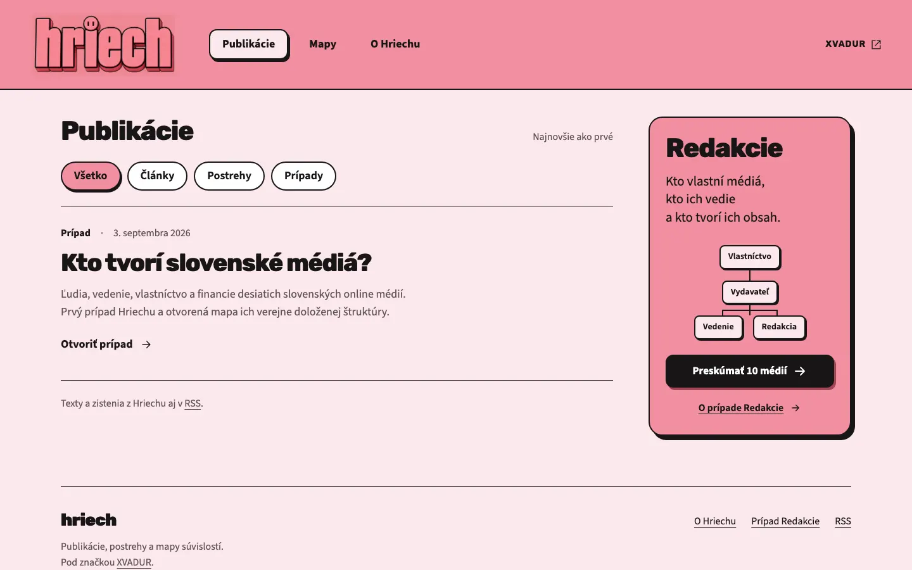
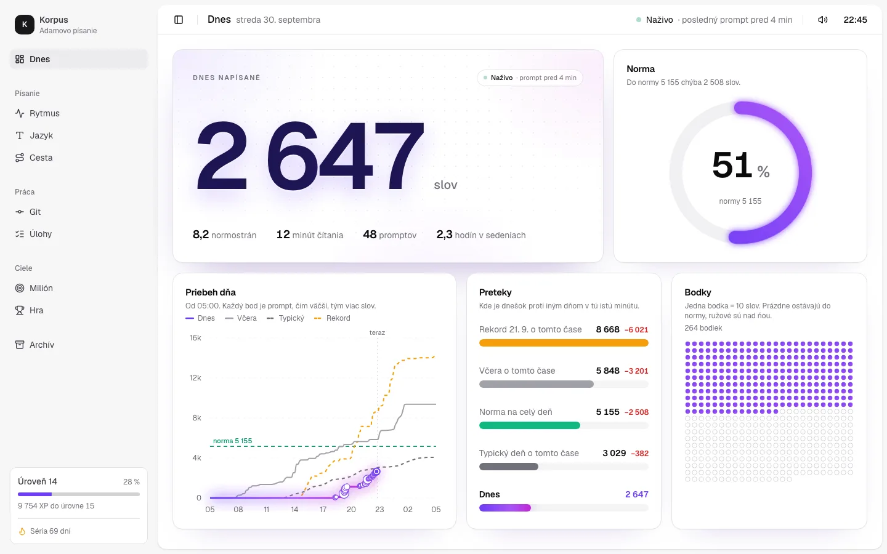
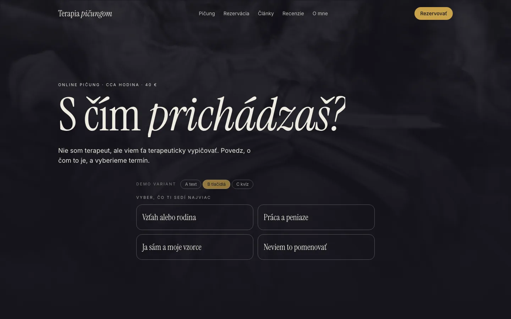
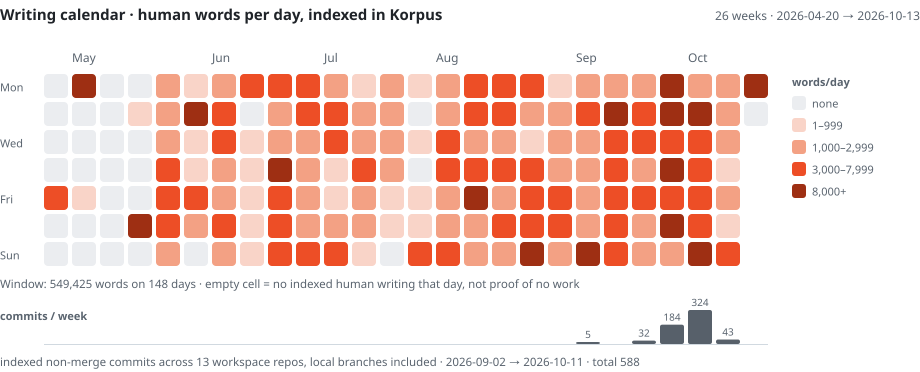
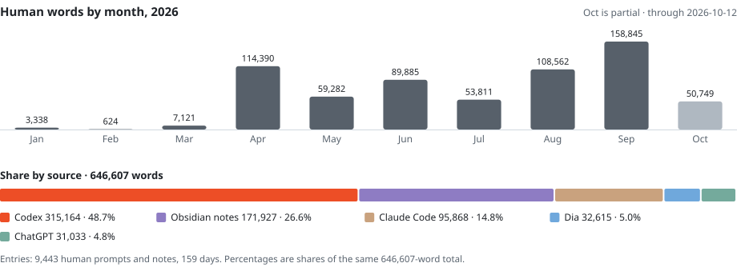

# I'm Adam. I write, research and build.

I'm Adam Rudavský, from Bratislava. I worked in healthcare from 2017 to 2025. Daily work with AI opened a door to building software, often by thinking out loud in Slovak.

I build under **XVADUR**. When I want to understand something, I tend to build a tool for it. My writing became **Korpus**. Questions about Slovak media became **Hriech / Netopier**. Client work became websites, workflows and video.

**[My website](https://xvadur.com)** · [Writing, in Slovak](https://xvadur.com/texty/) · [Say hello](mailto:adam@xvadur.com) · [Slovensky](README.sk.md)

> “AI is a sandbox, like Minecraft. The same game is completely different in two people's hands.”

## A few things from my world

<h3><a href="https://hriech.xvadur.com">Hriech / Netopier</a></h3>

I want to know where a public claim comes from. Hriech is my publication and map of Slovak media; Netopier is the research engine behind it. Documents, transcripts, connections and a trail back to the source.

<a href="https://hriech.xvadur.com">Explore the publication →</a> Public publication · research engine in development

<h3>Korpus</h3>

I wanted to see what my days actually contain. So I built a lab for my own words, prompts, notes and Git activity. Writing became something I could explore: its rhythm, language and history.

<a href="#yes-i-measure-it">A small public snapshot ↓</a> Private lab · selected aggregates shared below

<h3><a href="https://jakubolsa.sk">Jakub, a real-estate agent</a></h3>

A website built around the person doing the work. Alongside it, I'm developing the wider system for listings, enquiries, CRM and agent workflows.

<a href="https://jakubolsa.sk">Visit the website →</a> Public website · wider system in development

<h3><a href="https://picung.xvadur.com">Lucia / Terapia pičungom</a></h3>

A website with its own voice, a publishing workflow and a booking prototype. A very different person, so a very different website.

<a href="https://picung.xvadur.com">See the project →</a> Website and editorial prototype · booking is a demo

I also build **video workflows**: long recordings → transcripts → a meaningful edit → captions and motion → short videos. Local Whisper, Python and Remotion are part of that workshop.

## What stays after I close the chat?

That question runs through my work. I want a thought to become a useful tool, a published text or something another person can use. I work across the content, interface, data and automation, then inspect what came out.

I write about that process too: **[Čo zostane, keď zavriem chat](https://xvadur.com/texty/co-zostane-ked-zavriem-chat/)** — how I got from conversations with AI to systems I can return to the next day. In Slovak, like most of my thinking.

My workshop: **Astro · React / TypeScript · Python · SQLite · Cloudflare · Supabase · Remotion**, with Codex and Claude Code beside me.

## Yes, I measure it.

I got curious enough about my own working habits to build a whole system for them. This is a small, dated slice of that record.

<!-- generated:metrics:start -->
**646,607 of my own words indexed · 159 writing days · 588 workspace commits**

Frozen snapshot: **2026-10-13**. Partial 2026 writing index; commits from 13 local repositories, 2026-09-02 → 2026-10-11.

Open the notebook: writing rhythm, AI usage and sources

<picture>
  <source media="(prefers-color-scheme: dark)" srcset="assets/en/calendar-dark.svg">
  <source media="(prefers-color-scheme: light)" srcset="assets/en/calendar-light.svg">
  
</picture>

**549,425 words across 148 indexed days** in this 26-week window (2026-04-20 → 2026-10-13). Shades: 1–999 / 1,000–2,999 / 3,000–7,999 / 8,000+ words per day. Empty cells mean no indexed entry. Lower bars show weekly workspace commits.

| Measure | Value | Scope |
|---|---:|---|
| Human words indexed | **646,607** | Korpus, 2026-01-17 → 2026-10-12, human origin only |
| Writing days indexed | **159** | 9,443 entries; day boundary 05:00 Europe/Bratislava |
| Workspace commits | **588** | 13 local repositories, non-merge, 2026-09-02 → 2026-10-11 |
| Codex lifetime tokens | **22.4B** | provider screenshot, received 2026-10-11 |
| Claude Code total tokens | **14.4B** | 141 sessions, 49,318 messages, 27 active days; screenshot received 2026-10-11 |

<picture>
  <source media="(prefers-color-scheme: dark)" srcset="assets/en/sources-dark.svg">
  <source media="(prefers-color-scheme: light)" srcset="assets/en/sources-light.svg">
  
</picture>

By source: Codex 315,164 (48.7%); Obsidian notes 171,927 (26.6%); Claude Code 95,868 (14.8%); Dia 32,615 (5.0%); ChatGPT 31,033 (4.8%).

Snapshot `2026-10-13`. Token counts are two separate provider counters with different semantics and are not summed. The screenshots do not disclose their input/output/cache breakdown. Words are a partial 2026 index of my own writing, not a lifetime total. Definitions and evidence: [methodology](docs/methodology.md).

<!-- generated:metrics:end -->

---

**Have something worth figuring out or building?** [Tell me about it.](mailto:adam@xvadur.com)

[xvadur.com](https://xvadur.com) · Bratislava, Slovakia
