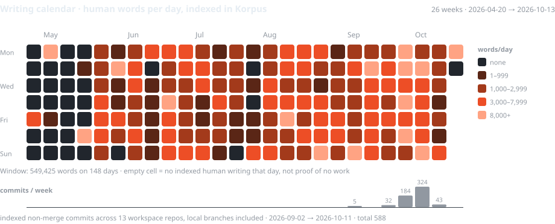
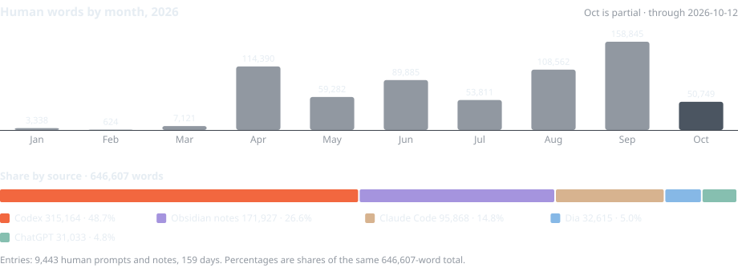

<!-- generated:board:start -->
<picture>
  <source media="(max-width: 600px)" srcset="assets/en/board-mobile-dark.svg">
  
</picture>
<!-- generated:board:end -->

I worked in healthcare from 2017 to 2025. Since January 2025, I have worked with AI every day. Today I build websites, agent workflows and research systems, and write.

My work spans client operations, public-source research, personal analytics and video production. I measure my practice: the writing, the tools, the changes and the systems that come out of it.

[Website](https://xvadur.com) · [Private Lab](https://adam.xvadur.com) · [adam@xvadur.com](mailto:adam@xvadur.com) · [Slovensky](README.sk.md)

## Systems I build

**Korpus — my own practice, made visible.**
A writing lab for words, prompts, notes, sessions, language and Git activity. Selected sources feed SQLite; an Astro + React interface lets me explore the record. It runs privately at [adam.xvadur.com](https://adam.xvadur.com), behind Cloudflare Access. This profile combines its daily aggregates with the wider Core V2 writing archive.

**Hriech / Netopier — research with a source trail.**
Slovak media and public-record research: collect documents, preserve their origins, examine claims and compare them over time. The publication and research engine are ongoing work, with the backend inside the [Hriech repository](https://github.com/xvadur/hriech).

**Jakub Olša — a website connected to the work.**
A real-estate site and a wider system for property listings, viewing requests, CRM and agent workflows. [jakubolsa.sk](https://jakubolsa.sk) is public. The wider booking and CRM project continues. Built with Astro, Supabase and Cloudflare Workers.

**Lucia / Pičung — publishing for a therapist.**
An Astro + Keystatic website and editorial prototype, so Lucia can manage her own content. The project is in development; the reservation flow is still a demonstration. More of my client work is on [xvadur.com](https://xvadur.com).

**Content engine — Fiki / Boris.**
Long recordings become source-led short videos: transcription, claim selection, meaning edit, captions and motion, then export for an account and date. Local MLX Whisper, Remotion and reusable client configuration support the craft. I publish the finished clips manually.

Earlier experiments include a voice reception demo, a senior-care map, personal health-data tools and knowledge systems. Writing in Obsidian remains part of the same practice.

## Measured practice

<!-- generated:metrics:start -->
<picture>
  
</picture>

**549,425 words across 148 indexed days** in this 26-week window (2026-04-20 → 2026-10-13). Shades: 1–999 / 1,000–2,999 / 3,000–7,999 / 8,000+ words per day. Empty cells mean no indexed entry. Lower bars show weekly workspace commits.

Exact figures, monthly trend and sources

| Measure | Value | Scope |
|---|---:|---|
| Own words archived · V2 estimate | **≈2.4M** | 2,409,914 words in own-labelled segments after archive-copy matching; 2017–2026, through 2026-10-14 |
| Human words indexed | **646,607** | Korpus, 2026-01-17 → 2026-10-12, human origin only |
| Writing days indexed | **159** | 9,443 entries; day boundary 05:00 Europe/Bratislava |
| Workspace commits | **588** | 13 local repositories, non-merge, 2026-09-02 → 2026-10-11 |
| Codex lifetime tokens | **22.4B** | provider screenshot, received 2026-10-11 |
| Claude Code total tokens | **14.4B** | 141 sessions, 49,318 messages, 27 active days; screenshot received 2026-10-11 |

<picture>
  
</picture>

By source: Codex 315,164 (48.7%); Obsidian notes 171,927 (26.6%); Claude Code 95,868 (14.8%); Dia 32,615 (5.0%); ChatGPT 31,033 (4.8%).

Snapshot `2026-10-13`. Token counts are two separate provider counters with different semantics and are not summed. The screenshots do not disclose their input/output/cache breakdown. The V2 headline estimates own-classified text in the available archive, including typing and dictation; it is not a count of newly composed or all lifetime words. The calendar and source chart use the separate 646,607-word Korpus index. Definitions and evidence: [methodology](docs/methodology.md).

<!-- generated:metrics:end -->

## How I work

Start with the real task and its sources. Write the specification, build with Codex and Claude Code, inspect the result, and keep a record of what changed. I work across the whole system: content, interface, data, automation and deployment.

Astro · React / TypeScript · Python · SQLite · Cloudflare Workers · Supabase · Remotion · Codex + Claude Code.

[Measurement definitions and evidence](docs/methodology.md) · [V2 writing aggregates](data/v2-writing.json) · [Korpus daily index](data/profile.json)

<!-- generated:snapshot:start -->
Core V2 through `2026-10-14`, reconciled `2026-10-17`: [own-writing aggregates](data/v2-writing.json). Korpus snapshot `2026-10-13` (Europe/Bratislava), last ingest `2026-10-13T07:20:32.666Z`: [daily index](data/profile.json). Generated by `scripts/render_profile.py`.
<!-- generated:snapshot:end -->
