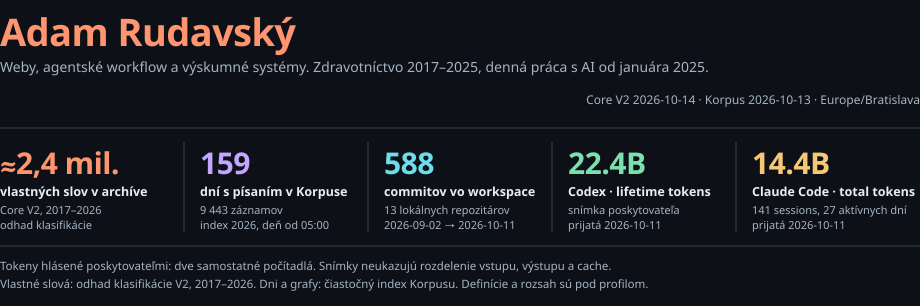
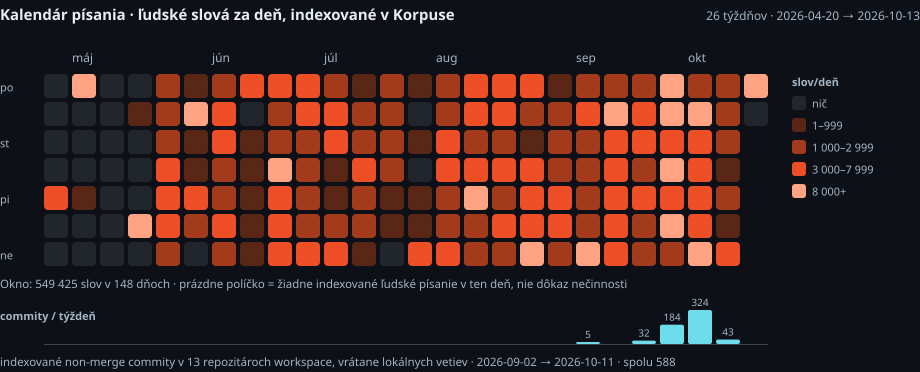
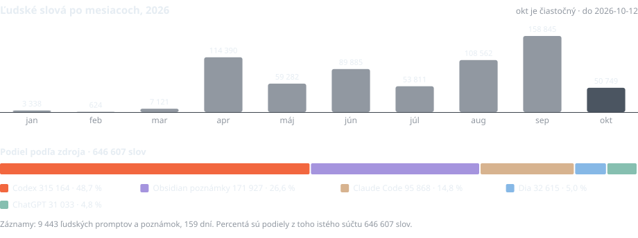

<!-- generated:board:start -->
<picture>
  <source media="(max-width: 600px)" srcset="assets/sk/board-mobile-dark.svg">
  
</picture>
<!-- generated:board:end -->

V rokoch 2017 až 2025 som pracoval v zdravotníctve. Od januára 2025 pracujem s AI každý deň. Dnes staviam weby, agentské workflow a výskumné systémy a píšem.

Moja práca siaha od prevádzky klientov cez výskum verejných zdrojov a vlastnú analytiku až po výrobu videa. Meriam svoju prax: písanie, nástroje, zmeny a systémy, ktoré z toho vznikajú.

[Web](https://xvadur.com) · [Súkromný Lab](https://adam.xvadur.com) · [adam@xvadur.com](mailto:adam@xvadur.com) · [English](README.md)

## Systémy, ktoré staviam

**Korpus — moja vlastná prax v číslach.**
Lab na slová, prompty, poznámky, pracovné relácie, jazyk a Git. Vybrané zdroje sa ukladajú do SQLite; rozhranie v Astro + React umožňuje preskúmať záznam. Beží na [adam.xvadur.com](https://adam.xvadur.com) za Cloudflare Access. Tento profil používa jeho agregované exporty.

**Hriech / Netopier — výskum so stopou k zdroju.**
Slovenské médiá a verejné záznamy: zozbierať dokumenty, zachovať ich pôvod, preskúmať tvrdenia a porovnať ich v čase. Publikácia aj výskumný stroj sa ďalej rozvíjajú; backend je súčasťou [repozitára Hriechu](https://github.com/xvadur/hriech).

**Jakub Olša — web prepojený s prácou makléra.**
Realitný web a širší systém ponúk, záujmu o obhliadky, CRM a agentských workflow. [jakubolsa.sk](https://jakubolsa.sk) je verejný. Projekt rezervácií a CRM pokračuje. Astro, Supabase a Cloudflare Workers.

**Lucia / Pičung — vlastné publikovanie pre terapeutku.**
Web a redakčný prototyp na Astro + Keystatic, aby si Lucia mohla spravovať obsah sama. Projekt je vo vývoji; rezervačný tok je zatiaľ ukážka. Ďalšia klientská práca je na [xvadur.com](https://xvadur.com).

**Obsahový stroj — Fiki / Boris.**
Z dlhých nahrávok vznikajú krátke videá: prepis, výber tvrdení zo zdroja, významový strih, titulky a pohyb, export podľa účtu a dátumu. Remeslo podporuje lokálny MLX Whisper, Remotion a opakovateľná konfigurácia klienta. Hotové klipy publikujem ručne.

Staršie experimenty zahŕňajú demo hlasovej recepcie, mapu starostlivosti o seniorov, nástroje na vlastné zdravotné dáta a systémy poznania. Písanie v Obsidiane zostáva súčasťou tej istej praxe.

## Meraná prax

<!-- generated:metrics:start -->
<picture>
  
</picture>

**549 425 slov v 148 dňoch so záznamom** v tomto 26-týždňovom okne (2026-04-20 → 2026-10-13). Odtiene: 1–999 / 1 000–2 999 / 3 000–7 999 / 8 000+ slov za deň. Prázdne políčko znamená chýbajúci záznam. Spodné stĺpce ukazujú týždenné commity.

Presné čísla, mesačný vývoj a zdroje

| Miera | Hodnota | Rozsah |
|---|---:|---|
| Ľudských slov v indexe | **646 607** | Korpus, 2026-01-17 → 2026-10-12, iba ľudský pôvod |
| Dní s indexovaným písaním | **159** | 9 443 záznamov; hranica dňa 05:00 Europe/Bratislava |
| Commitov vo workspace | **588** | 13 lokálnych repozitárov, bez merge, 2026-09-02 → 2026-10-11 |
| Codex lifetime tokens | **22.4B** | snímka obrazovky poskytovateľa, prijatá 2026-10-11 |
| Claude Code total tokens | **14.4B** | 141 sessions, 49 318 správ, 27 aktívnych dní; snímka prijatá 2026-10-11 |

<picture>
  
</picture>

Podľa zdroja: Codex 315 164 (48,7 %); Obsidian poznámky 171 927 (26,6 %); Claude Code 95 868 (14,8 %); Dia 32 615 (5,0 %); ChatGPT 31 033 (4,8 %).

Snímka `2026-10-13`. Počty tokenov sú dve oddelené počítadlá poskytovateľov s rôznou sémantikou a nesčítavajú sa. Snímky neukazujú rozdelenie vstupu, výstupu a cache. Slová sú čiastočný index môjho písania za rok 2026, nie celoživotný súčet. Definície a dôkazy: [metodika](docs/methodology.md).

<!-- generated:metrics:end -->

## Ako pracujem

Začnem reálnou úlohou a jej zdrojmi. Napíšem špecifikáciu, staviam s Codexom a Claude Code, pozriem sa na výsledok a zachovám záznam zmien. Pracujem naprieč celým systémom: obsah, rozhranie, dáta, automatizácia a nasadenie.

Astro · React / TypeScript · Python · SQLite · Cloudflare Workers · Supabase · Remotion · Codex + Claude Code.

[Definície merania a dôkazy](docs/methodology.md) · [Agregované dáta](data/profile.json)

<!-- generated:snapshot:start -->
Snímka `2026-10-13` (Europe/Bratislava), posledný ingest Korpusu `2026-10-13T07:20:32.666Z`. Vygenerované z [data/profile.json](data/profile.json) skriptom `scripts/render_profile.py`.
<!-- generated:snapshot:end -->
