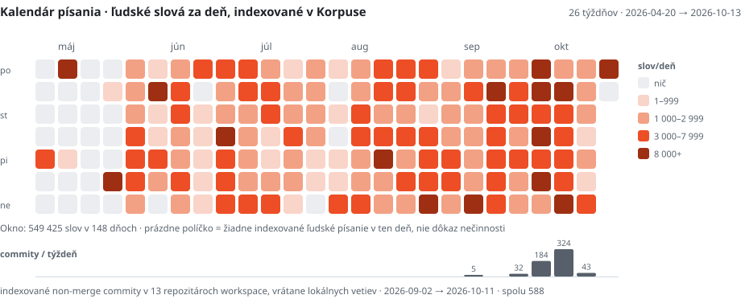
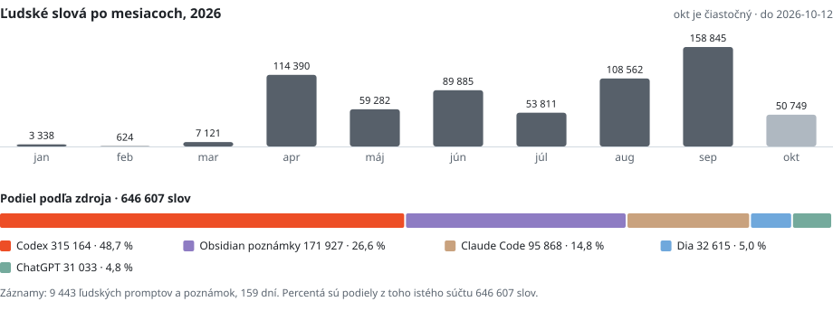

# Som Adam. Píšem, skúmam a staviam.

Som Adam Rudavský, z Bratislavy. V rokoch 2017–2025 som pracoval v zdravotníctve. Denná práca s AI mi otvorila dvere k stavaniu softvéru, často premýšľaním nahlas po slovensky.

Tvorím pod menom **XVADUR**. Keď chcem niečomu rozumieť, často si na to postavím vlastný nástroj. Z môjho písania vznikol **Korpus**. Z otázok o slovenských médiách **Hriech / Netopier**. Z klientskych spoluprác weby, pracovné postupy a videá.

**[Môj web](https://xvadur.com)** · [Texty](https://xvadur.com/texty/) · [Napíš mi](mailto:adam@xvadur.com) · [English](README.md)

> „AI je sandbox, ako Minecraft. Tá istá hra je v rukách dvoch ľudí absolútne odlišná.“

## Pár vecí z môjho sveta

<h3><a href="https://hriech.xvadur.com">Hriech / Netopier</a></h3>

Chcem vedieť, odkiaľ pochádza verejné tvrdenie. Hriech je moja publikácia a mapa slovenských médií; Netopier je výskumný stroj v pozadí. Dokumenty, prepisy, súvislosti a cesta späť k zdroju.

<a href="https://hriech.xvadur.com">Pozri si publikáciu →</a> Verejná publikácia · výskumný stroj vo vývoji

<h3>Korpus</h3>

Chcel som vidieť, čo vlastne obsahujú moje dni. Postavil som si lab na vlastné slová, prompty, poznámky a Git. Písanie sa stalo niečím, čo môžem skúmať: jeho rytmus, jazyk aj históriu.

<a href="#áno-meriam-si-to">Malá verejná snímka ↓</a> Súkromný lab · vybrané súčty sú nižšie

<h3><a href="https://jakubolsa.sk">Jakub, realitný maklér</a></h3>

Web okolo človeka, ktorý tú prácu robí. Popri ňom vyvíjam širší systém ponúk, dopytov, CRM a pracovných postupov pre agenta.

<a href="https://jakubolsa.sk">Otvor si web →</a> Verejný web · širší systém vo vývoji

<h3><a href="https://picung.xvadur.com">Lucia / Terapia pičungom</a></h3>

Web s vlastným hlasom, publikovaním a prototypom rezervácie. Úplne iný človek, a preto aj úplne iný web.

<a href="https://picung.xvadur.com">Pozri si projekt →</a> Web a redakčný prototyp · rezervácia je demo

Staviam aj **postupy na výrobu videa**: dlhá nahrávka → prepis → významový strih → titulky a pohyb → krátke videá. Súčasťou tej dielne sú lokálny Whisper, Python a Remotion.

## Čo zostane, keď zavriem chat?

Tá otázka sa mi vracia naprieč prácou. Chcem, aby z myšlienky vznikol použiteľný nástroj, publikovaný text alebo vec, s ktorou môže pracovať ďalší človek. Prechádzam cez obsah, rozhranie, dáta aj automatizáciu a pozerám sa, čo z toho vyšlo.

Aj o tom píšem: **[Čo zostane, keď zavriem chat](https://xvadur.com/texty/co-zostane-ked-zavriem-chat/)** — ako som sa od rozhovorov s AI dostal k systémom, ku ktorým sa viem na druhý deň vrátiť.

Moja dielňa: **Astro · React / TypeScript · Python · SQLite · Cloudflare · Supabase · Remotion**, s Codexom a Claude Code po boku.

## Áno, meriam si to.

Vlastné pracovné návyky ma zaujímali natoľko, že som si na ne postavil celý systém. Toto je malý, časovo ohraničený výsek jeho záznamu.

<!-- generated:metrics:start -->
**646 607 vlastných slov v indexe · 159 dní s písaním · 588 commitov vo workspace**

Uzavretá snímka: **2026-10-13**. Čiastočný index písania za rok 2026; commity z 13 lokálnych repozitárov, 2026-09-02 → 2026-10-11.

Otvor zápisník: rytmus písania, používanie AI a zdroje

<picture>
  <source media="(prefers-color-scheme: dark)" srcset="assets/sk/calendar-dark.svg">
  <source media="(prefers-color-scheme: light)" srcset="assets/sk/calendar-light.svg">
  
</picture>

**549 425 slov v 148 dňoch so záznamom** v tomto 26-týždňovom okne (2026-04-20 → 2026-10-13). Odtiene: 1–999 / 1 000–2 999 / 3 000–7 999 / 8 000+ slov za deň. Prázdne políčko znamená chýbajúci záznam. Spodné stĺpce ukazujú týždenné commity.

| Miera | Hodnota | Rozsah |
|---|---:|---|
| Ľudských slov v indexe | **646 607** | Korpus, 2026-01-17 → 2026-10-12, iba ľudský pôvod |
| Dní s indexovaným písaním | **159** | 9 443 záznamov; hranica dňa 05:00 Europe/Bratislava |
| Commitov vo workspace | **588** | 13 lokálnych repozitárov, bez merge, 2026-09-02 → 2026-10-11 |
| Codex lifetime tokens | **22.4B** | snímka obrazovky poskytovateľa, prijatá 2026-10-11 |
| Claude Code total tokens | **14.4B** | 141 sessions, 49 318 správ, 27 aktívnych dní; snímka prijatá 2026-10-11 |

<picture>
  <source media="(prefers-color-scheme: dark)" srcset="assets/sk/sources-dark.svg">
  <source media="(prefers-color-scheme: light)" srcset="assets/sk/sources-light.svg">
  
</picture>

Podľa zdroja: Codex 315 164 (48,7 %); Obsidian poznámky 171 927 (26,6 %); Claude Code 95 868 (14,8 %); Dia 32 615 (5,0 %); ChatGPT 31 033 (4,8 %).

Snímka `2026-10-13`. Počty tokenov sú dve oddelené počítadlá poskytovateľov s rôznou sémantikou a nesčítavajú sa. Snímky neukazujú rozdelenie vstupu, výstupu a cache. Slová sú čiastočný index môjho písania za rok 2026, nie celoživotný súčet. Definície a dôkazy: [metodika](docs/methodology.md).

<!-- generated:metrics:end -->

---

**Máš niečo, čomu sa oplatí porozumieť alebo to postaviť?** [Napíš mi o tom.](mailto:adam@xvadur.com)

[xvadur.com](https://xvadur.com) · Bratislava, Slovensko
